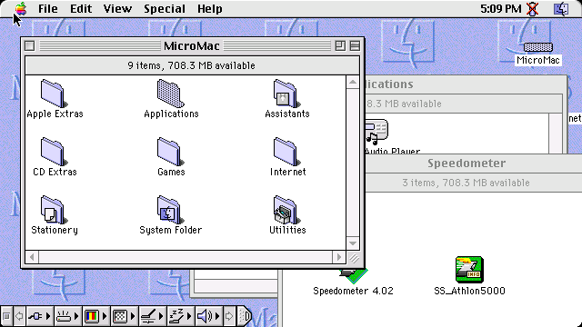
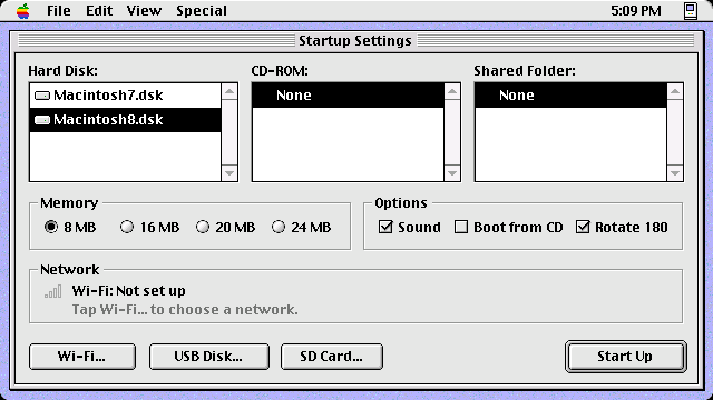
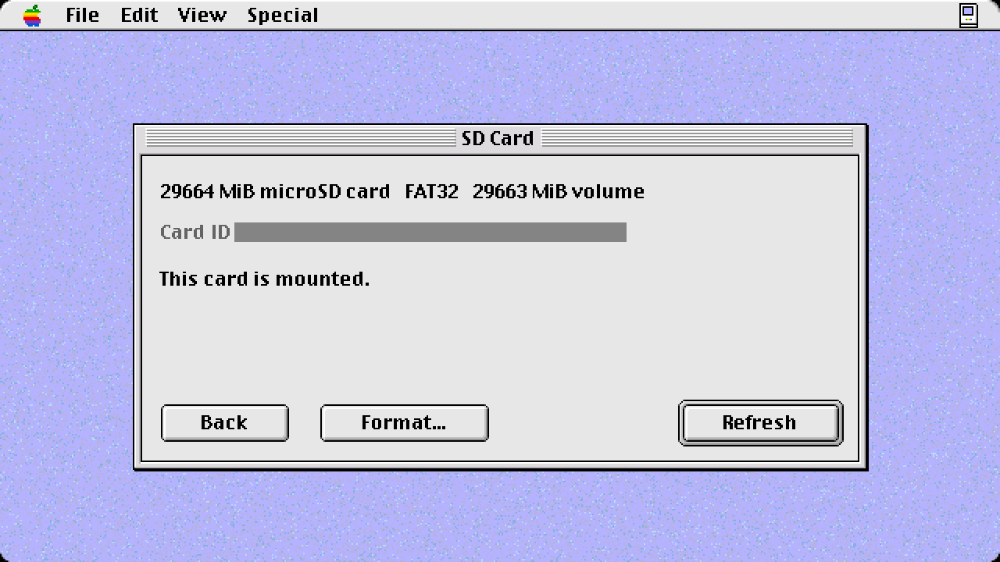
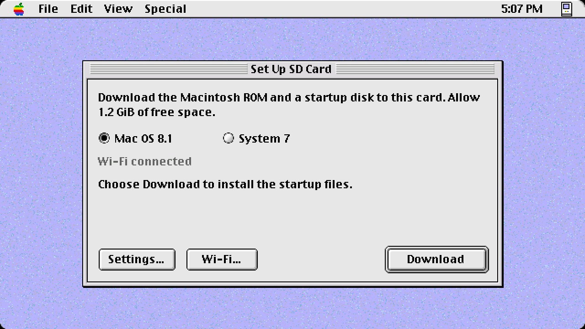
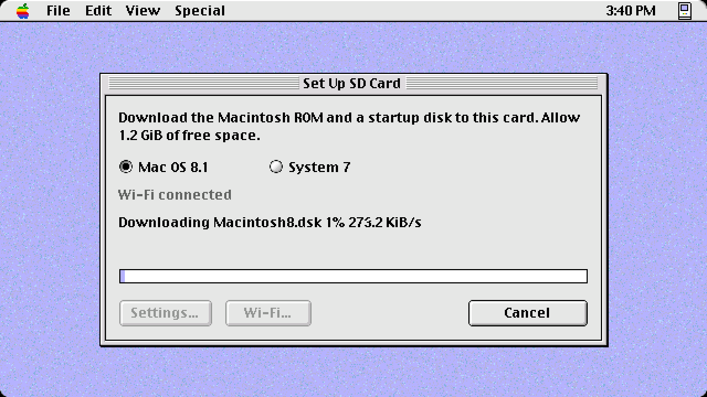
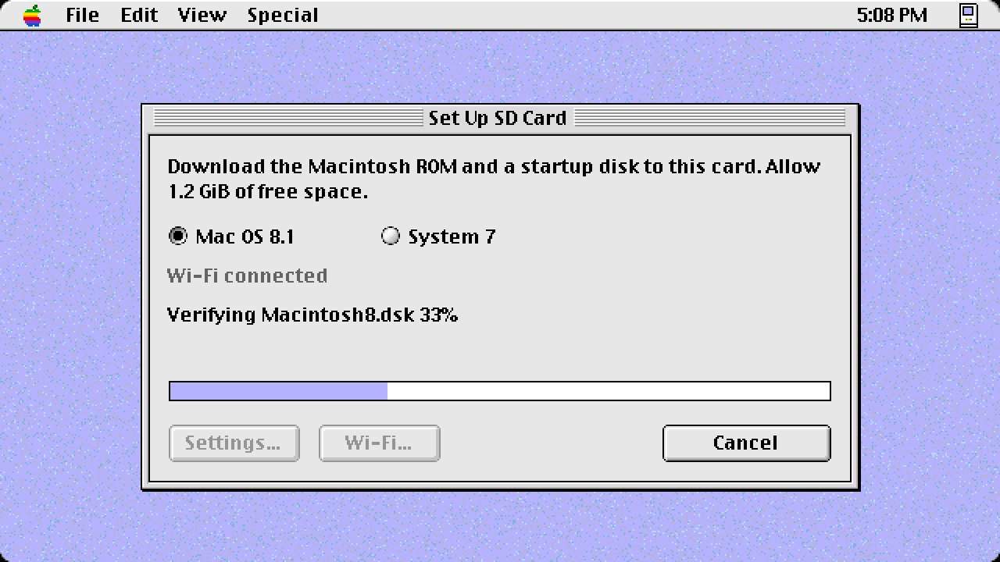
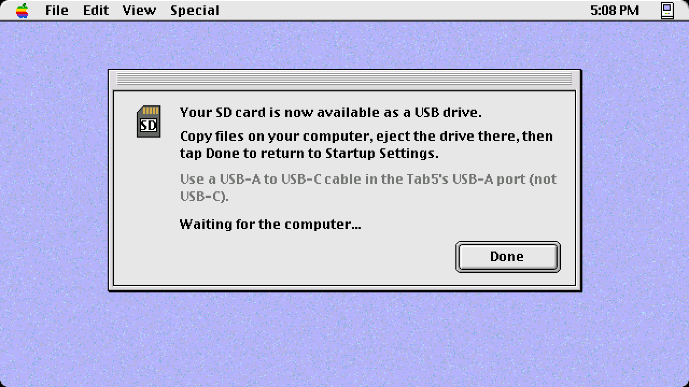
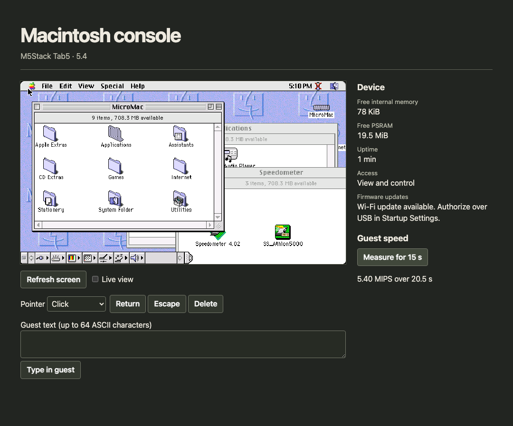

# M5Tab Macintosh

Run classic Macintosh System 7 through Mac OS 8.1 on an M5Stack Tab5 or Waveshare ESP32-P4-WIFI6-Touch-LCD-10.1. The ESP32-P4 runs Basilisk II. The removable microSD card holds the Macintosh ROM, disks and settings.

**[Download stable v5.4](https://github.com/amcchord/M5Tab-Macintosh/releases/tag/v5.4)** · [Flash your board](#flashing-the-firmware) · [Set up a card](#sd-card-setup) · [Release notes](RELEASE_NOTES.md)

| Mac OS 8.1 on the Tab5 | Finder on the emulated Macintosh |
| --- | --- |
|  |  |

## Flashing the firmware

For a first installation you need a computer, a USB data cable and the **merged** firmware image for your board. On the Tab5, connect the computer to USB-C. On the Waveshare, use the port marked **UART**.

A merged flash replaces the bootloader, any installed launcher and the partition table. Save a full flash backup first if you want to restore the existing installation. If you already use the optional two-slot layout, install the matching **`-app.bin`** with the Wi-Fi updater to preserve that layout. USB authorizes each update. [Backup, two-slot setup and update instructions](WIFI_UPDATE.md)

1. Install esptool 5. On macOS or Linux, run the following in a terminal. On Windows, create the environment with `py -m venv .venv` and activate it with `.venv\Scripts\activate` in Command Prompt.

   ```sh
   python3 -m venv .venv
   . .venv/bin/activate
   python -m pip install "esptool>=5,<6"
   ```

2. Read the **ESP32-P4 chip revision**. Replace `PORT` in the examples with your serial port, such as `/dev/cu.usbmodem101` on macOS, `/dev/ttyACM0` on Linux or `COM3` on Windows. The panel or PCB revision is a separate number.

   ```sh
   python -m esptool --chip esp32p4 --port PORT chip-id
   ```

3. Download the image for that revision. A chip reporting **v1.3**, for example, takes a pre-v3 image. The production builds require **v3.1 or later**. This release has no image for v3.0.

   | Board | Pre-v3 ESP32-P4 | ESP32-P4 v3.1 or later |
   | --- | --- | --- |
   | M5Stack Tab5 | [Tab5](https://github.com/amcchord/M5Tab-Macintosh/releases/download/v5.4/M5Tab-Macintosh-v5.4.bin) | [Tab5 Rev3](https://github.com/amcchord/M5Tab-Macintosh/releases/download/v5.4/M5Tab-Macintosh-Rev3-v5.4.bin) |
   | Waveshare 10.1″ | [Waveshare 10.1](https://github.com/amcchord/M5Tab-Macintosh/releases/download/v5.4/M5Tab-Macintosh-Waveshare-P4-10.1-v5.4.bin) | [Waveshare 10.1 Rev3](https://github.com/amcchord/M5Tab-Macintosh/releases/download/v5.4/M5Tab-Macintosh-Waveshare-P4-10.1-Rev3-v5.4.bin) |

   The optional pre-v3 Tab5 USB Debug build uses a newer Espressif SDK. The release also includes SHA-256 checksums for every download. [USB Debug firmware](https://github.com/amcchord/M5Tab-Macintosh/releases/download/v5.4/M5Tab-Macintosh-USB-Debug-v5.4.bin) · [SHA256SUMS](https://github.com/amcchord/M5Tab-Macintosh/releases/download/v5.4/SHA256SUMS)

4. Run this command from the download folder, substituting the filename you chose. This example installs a standard pre-v3 Tab5.

   ```sh
   python -m esptool --chip esp32p4 --port PORT --baud 921600 write-flash 0x0 M5Tab-Macintosh-v5.4.bin
   ```

## SD card setup

### Set up a spare card on the Tab5

1. Insert a microSD card and start the Tab5. A **FAT32** card with **at least 1.2 GiB free** can go straight to setup. If the Tab5 cannot mount the card, **SD Card** shows its identity, capacity and detected format. Try **Retry Mount** after reseating it.
2. To erase a spare card, choose **Format…**, verify the displayed card, then choose **Erase Card**. **This erases every file and partition on that card.** The Tab5 creates a FAT32 volume and restarts. A mounted card can also be inspected under **Startup Settings → SD Card…**. [View the erase confirmation](screenshots/Tab5-Format-Confirm.png)

   | Startup Settings | Inspect a card before formatting |
   | --- | --- |
   |  |  |

3. **Set Up SD Card** opens when the ROM or selected startup disk is missing. Tap **Wi-Fi…**, select your network, enter the password, tap **Join**, then return to setup. Choose **Mac OS 8.1** or **System 7.5.3** and tap **Download**.
4. Leave the card seated while the installer downloads, unpacks and reads back the ROM and disk. Downloads resume from the saved byte after a network interruption. If the automatic retries run out, reconnect and tap **Retry**. Tap **Start Up** after verification.

   | Choose the operating system | Download the selected files | Verify the disk image |
   | --- | --- | --- |
   |  |  |  |

### Prepare a card on your computer

Use a FAT32 card and copy the **contents** of the archive’s `sdCard` folder to the card root. You should see `Q650.ROM` and the Macintosh disk images at the top level. Eject the card, insert it in the board, and tap the Happy Mac splash to select a startup disk in **Startup Settings**. This works on either board. You can also supply your own ROM and disk images. [Download sdCard.zip](https://www.mcchord.net/static/sdCard.zip) · [Using your own images](USER_GUIDE.md#macintosh-media)

## Using the Macintosh

- **Mouse and keyboard.** Tap to click, drag to move an item, or plug a USB keyboard or mouse into the host port. A three-finger tap opens the on-screen keyboard. A four-finger tap opens the game controls. Repeat the gesture to close the overlay. The official Tab5 Keyboard connects to Ext.Port1.
- **Startup Settings.** Tap the Happy Mac splash after power-on to change disks, RAM, audio, Wi-Fi or shared folders. With a usable disk and no tap, the last configuration boots automatically.
- **File transfer.** Choose an SD folder under **Shared Folder** in Startup Settings to see it as a volume in Finder. Shut down from Finder before removing the card. [Media, settings and recovery](USER_GUIDE.md)
- **Power.** On the Tab5, Mac OS 8’s Control Strip shows battery charge and **Special → Sleep** turns off the display. Mac Extras includes the optional Brightness module. [Mac Extras download](https://github.com/amcchord/M5Tab-Macintosh/releases/download/v5.4/M5Tab-Macintosh-Mac-Extras-v5.4.zip) · [Install Brightness](POWER_MANAGEMENT.md#installing-the-brightness-module)

### Use the Tab5 as a USB card reader

In Startup Settings, select **USB Disk…**. Connect the Tab5’s **USB-A** port to the computer with a USB-A to USB-C data cable. The USB-C programming connection can stay attached. Copy files, eject the drive on the computer, then tap **Done** on the Tab5. The Tab5 restarts to release the USB port. A separate microSD reader also works.



### Remote access and performance

Join a trusted Wi-Fi network, boot the Macintosh, then pair the browser over the programming USB cable. From the extracted Host Tools folder, run the following with your Python environment active. Open the full URL printed by the second command.

```sh
python -m pip install -r tools/requirements.txt
python tools/mac_control.py --no-reset web-open
```

The browser shows the guest screen, memory use and firmware version. **Measure for 15 s** measures the running guest. Pair with `web-open --control` to send clicks, double-clicks and text. The P4 serves the page over the stock C6 radio. Sessions use local HTTP and expire after 30 minutes. [Host Tools download](https://github.com/amcchord/M5Tab-Macintosh/releases/download/v5.4/M5Tab-Macintosh-Host-Tools-v5.4.zip) · [Browser and USB controls](AUTOMATION.md#wi-fi-console)



The Tab5 uses four-bit SD access when the card supports it. In a System 7.5.3 test on the same card, reading a 4 MiB file was about 4.5× faster and writing and flushing it was 1.6–2.1× faster than on the legacy SPI connection. [Disk benchmarks](SD_STABILITY.md#disk-performance-inside-system-753)

## Build from source

Use PlatformIO Core 6.1.19 or later and Python 3.10–3.13. The example builds the standard pre-v3 Tab5 firmware from the stable tag. The source-only build runs the 68k interpreter. The release binaries also include translated ROM and system code. [Board build environments and translation tools](USER_GUIDE.md#build-environments)

```sh
git clone --branch v5.4 https://github.com/amcchord/M5Tab-Macintosh.git
cd M5Tab-Macintosh
pio run -e esp32p4_pioarduino
```

## Credits and license

This port uses Christian Bauer and contributors’ Basilisk II, the UAE 68k CPU core, Espressif’s ESP32 software, M5Stack’s M5Unified and M5GFX libraries, and Waveshare’s board drivers. Claude assisted with development. Basilisk II is distributed under the GNU General Public License, version 2 or later. [Basilisk II](https://github.com/cebix/macemu/tree/master/BasiliskII) · [GNU GPL v2](https://www.gnu.org/licenses/old-licenses/gpl-2.0.html)
