# Tab5 v5.4 screenshot gallery

## Startup and setup

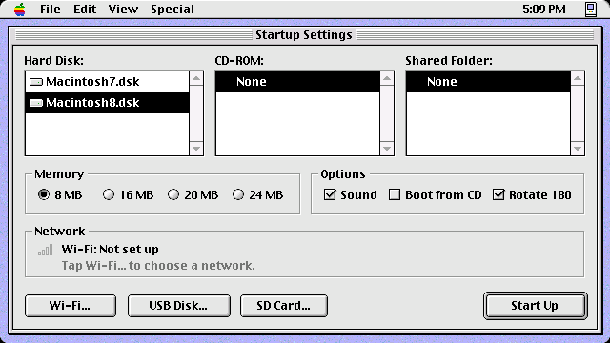

**Startup Settings.** Choose a Macintosh hard disk, optional CD-ROM and memory size, then select **Start Up**.

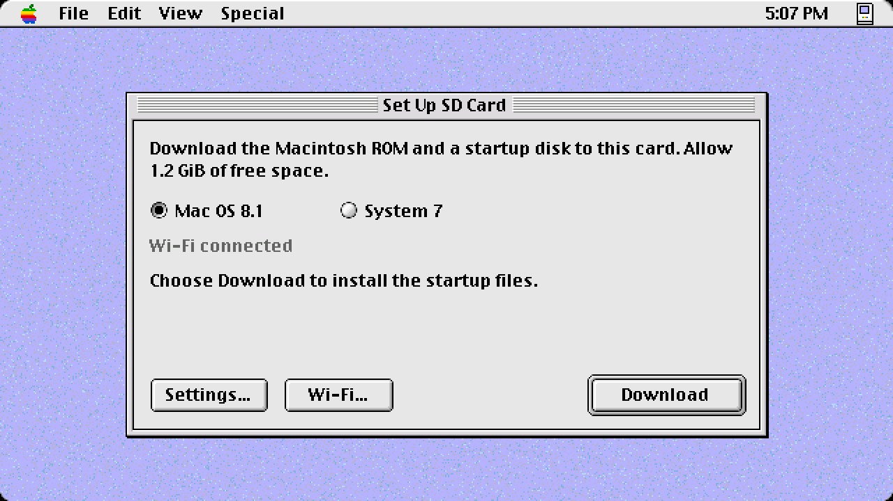

**Set Up SD Card.** Connect to Wi-Fi and choose Mac OS 8.1 or System 7. Setup downloads the Macintosh ROM and the selected startup disk. Allow 1.2 GiB of free space on the card.

## Download, installation and verification

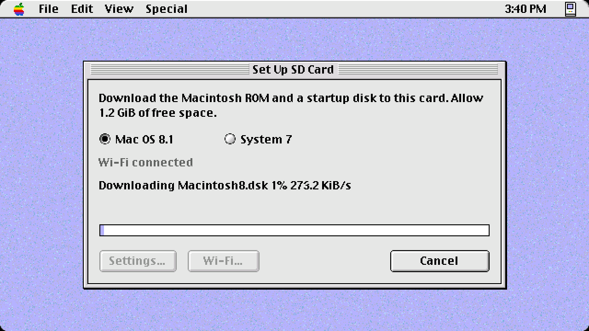

**Downloading.** This Tab5 capture shows the Mac OS 8.1 download at 273.2 KiB/s. An interrupted download can resume from the bytes saved on the card.

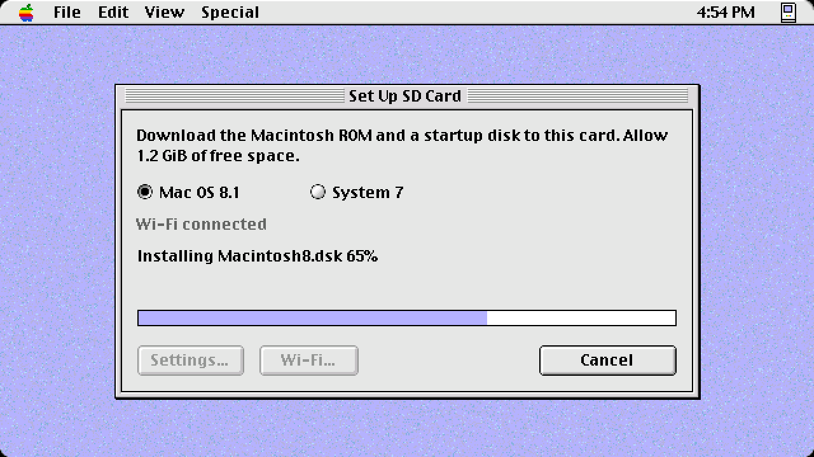

**Installing.** The original v5.4 renderer drew this illustration from a recorded Tab5 progress sample. Setup had expanded and written 687,407,104 of 1,048,576,000 bytes to `Macintosh8.dsk` (65%).

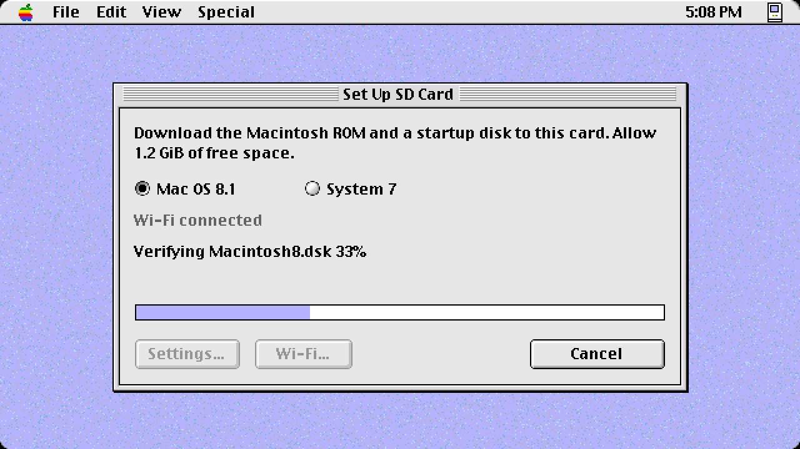

**Verifying.** Setup checks the compressed download, expands the disk image onto the card, then rereads and verifies the installed image. The network speed appears only during the download.

## Card management

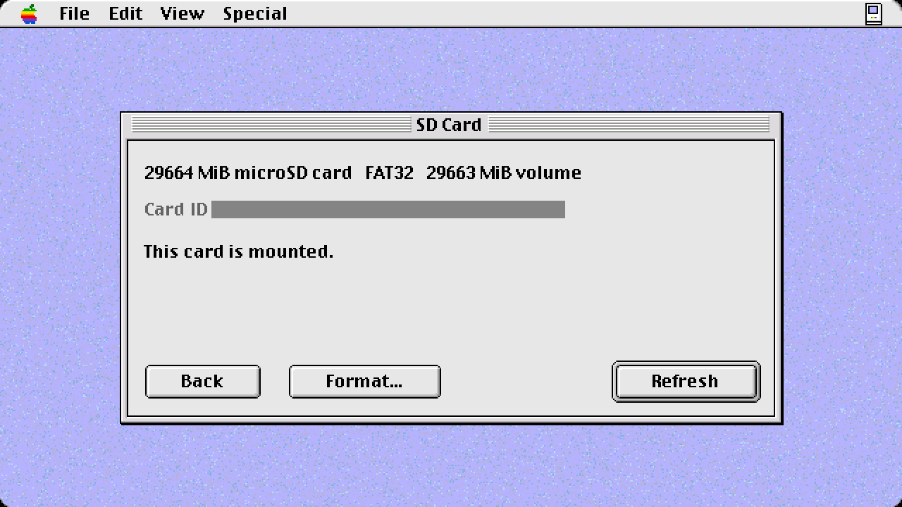

**SD Card.** Check the card identity, physical capacity, filesystem and volume size before choosing a card action.

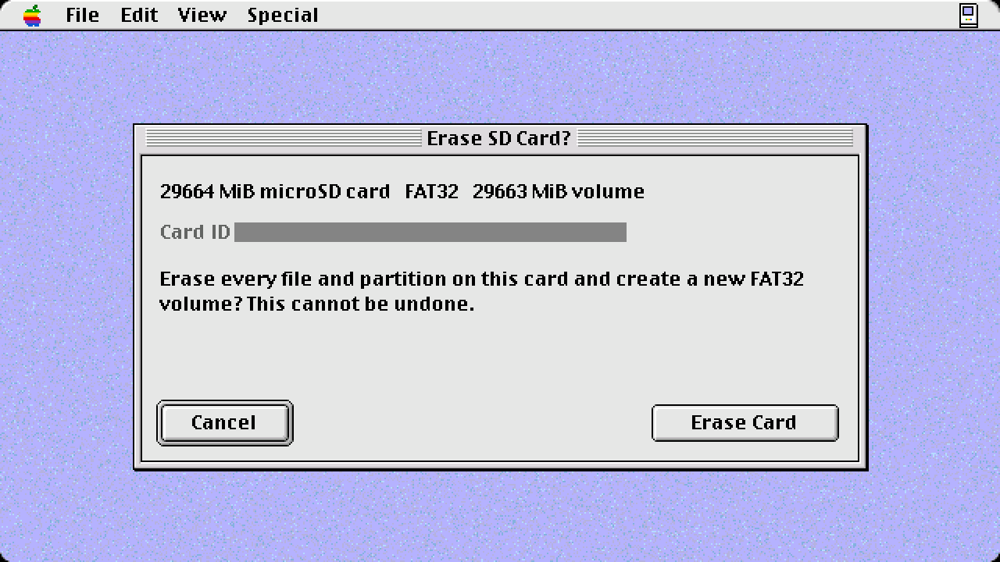

**Erase SD Card?** The confirmation names the card. **Erase Card** removes every file and partition and creates a FAT32 volume. **Cancel** returns to inspection.

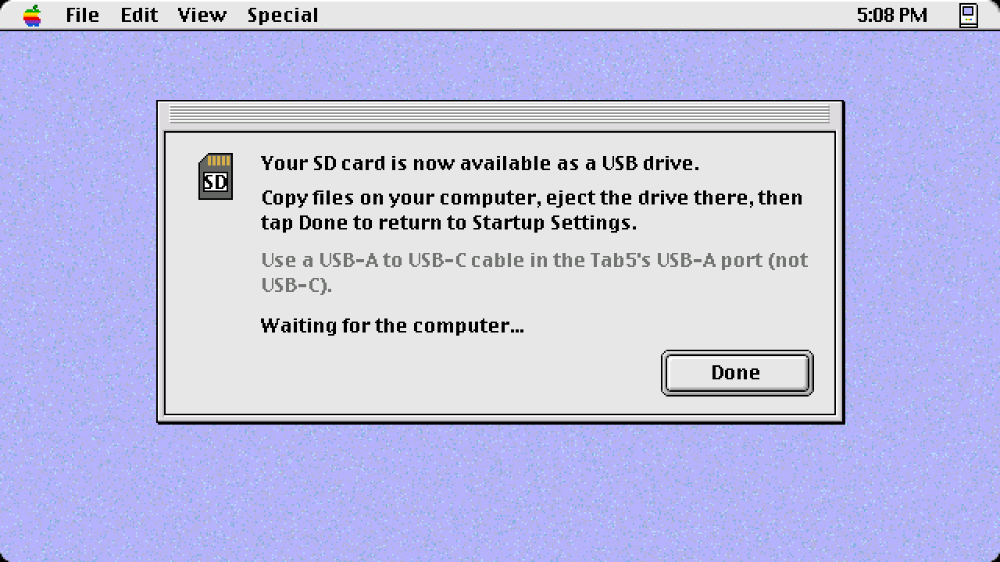

**USB Disk.** Connect a computer to the Tab5’s USB-A port to access the card. Eject the mounted card on the computer before leaving USB Disk mode.

## Finder and disk performance

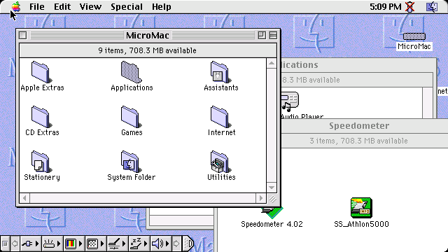

**Finder.** The Macintosh desktop after startup on the Tab5.

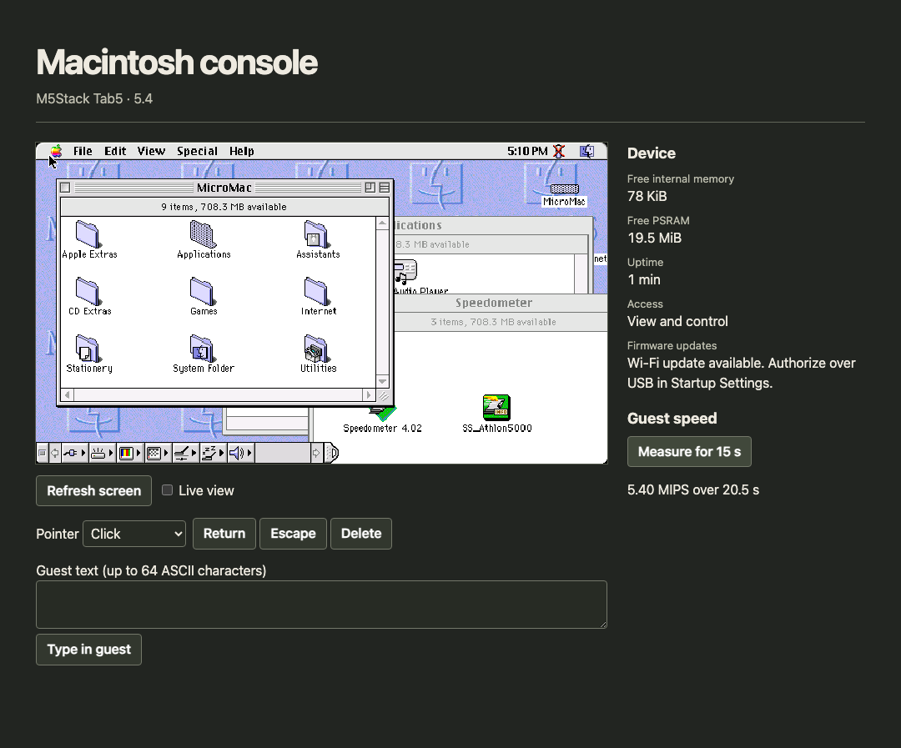

**Wi-Fi console.** Open the console in a browser to view the Macintosh display, check performance or send mouse and keyboard input. [Wi-Fi console instructions](AUTOMATION.md#wi-fi-console)

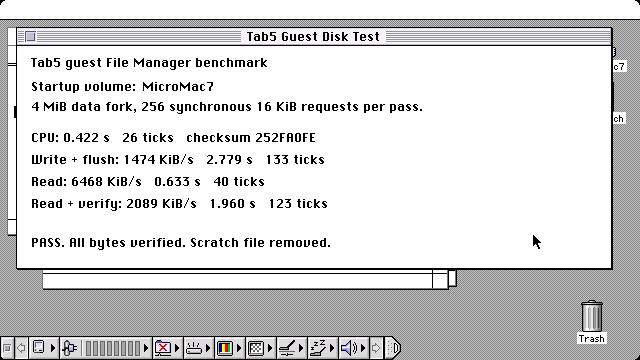

**Guest disk test.** The benchmark writes 4 MiB to the Macintosh startup volume, reads it back, verifies every byte and removes its test file. [Four-bit SDMMC and SPI measurements](SD_STABILITY.md)

## Touch input

| QWERTY keyboard on Tab5 | Game controls on Tab5 |
| --- | --- |
|  |  |
| Three-finger tap to show or hide the keyboard. | Four-finger tap to show or hide the D-pad. |

The photos above show the v4 controls on a physical Tab5. [Keyboard on the Waveshare 10.1-inch display](screenshots/v4-WaveshareBootKeyboard.jpeg)

## Earlier releases

Boot recordings and Flying Toasters

**System 7.5.3 startup.** A recording of the physical display. [Boot video (MOV)](https://github.com/amcchord/M5Tab-Macintosh/blob/v5.4/screenshots/MacOS753_Booting.mov)

**Flying Toasters.** After Dark running on the Tab5 in v2.5. [Original recording (GIF)](screenshots/Toasters.gif)

Hardware photos, benchmarks and web browsing

| Mac OS 8.1 startup on the Tab5 | Mac OS 8.1 Finder on the Tab5 |
| --- | --- |
|  |  |

**About This Computer.** [Mac OS 8.1 photo](screenshots/MacOS8.1_About.jpeg) and [System 7.5.3 photo](screenshots/MacOS753_About.jpeg).

**Speedometer.** The Performance Test window photographed on the Tab5 in [v2.5](screenshots/2-5-Performance.jpeg) and [v3.0](screenshots/3-0-Performance.png).

**Web browsing over Wi-Fi.** Internet Explorer on System 7 displaying the System 7 Today site. [Forum photo](screenshots/Internert-Forums.jpg) · [Page load video (MP4)](https://github.com/amcchord/M5Tab-Macintosh/blob/v5.4/screenshots/LoadingAWebpage.mp4)

